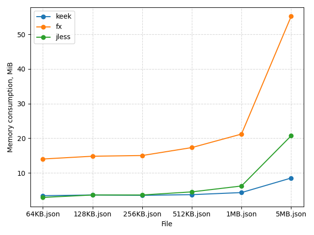

# keek - _to peek; peep_

A simple JSON file viewer with a terminal user interface, designed to handle large files. Select values in the viewer, and they will be printed to `stdout` when you exit.


Run it with [`cargo`](https://doc.rust-lang.org/cargo/):

```bash
cargo run --release <FILE>
```

or with [`nix`](https://nixos.org/):

```bash
nix run github:mnmun/keek <FILE>
```

## Built with


<br>
<br>

The `keek` uses the parser from the [`lazy_json`](https://github.com/mnmun/lazy_json) crate, which provides fast, memory-efficient JSON parsing. The parser analyzes only the part of the file currently needed for display.

<br>


<br>
<br>

The `keek's` interface is built with the [`ratwrap`](https://github.com/mnmun/ratwrap) crate - a retained-mode wrapper around the [`ratatui`](https://docs.rs/ratatui/0.30.2/ratatui/) crate that provides a widget tree with guard-based incremental updates.

<br>

## Comparison

To evaluate `keek's` performance, I compared it with two similar programs, [`fx`](https://fx.wtf/) and [`jless`](https://jless.io/), which appeared near the top of DuckDuckGo results for ["terminal JSON viewer"](https://noai.duckduckgo.com/?q=terminal+JSON+viewers&noai=1&ia=web) search.

### Memory consumption

The table below compares the programs memory consumption, in mebibytes (**MiB**), when viewing files from the [dataset](https://microsoftedge.github.io/Demos/json-dummy-data/):

|       | 64KB.json | 128KB.json | 256KB.json | 512KB.json | 1MB.json | 5MB.json |
|-------|-----------|------------|------------|------------|----------|----------|
| keek  | 3.4       | 3.6        | 3.5        | 3.7        | 4.3      | 8.5      |
| fx    | 14.0      | 14.8       | 15.0       | 17.3       | 21.2     | 55.2     |
| jless | 2.9       | 3.6        | 3.6        | 4.5        | 6.2      | 20.7     |

The plot below provides a clearer comparison:



Among the programs tested, `keek` shows the smallest increase in memory consumption as file size grows.

### Files with invalid markup

The [dataset](https://microsoftedge.github.io/Demos/json-dummy-data/) used to compare memory consumption also contains three files with invalid JSON: `missing-colon.json`, `unterminated.json` and `binary-data.json`. 

Among the viewers tested, only the `keek` viewer was able to open the `missing-colon.json` file. This is due to how the `lazy_json` parser works - it parses only the part of the JSON structure currently displayed on screen. If malformed JSON comes into view, `keek` exits with a syntax error, just like other tested viewers.

None of the viewers tested could open the `unterminated.json` and `binary-data.json` files.

